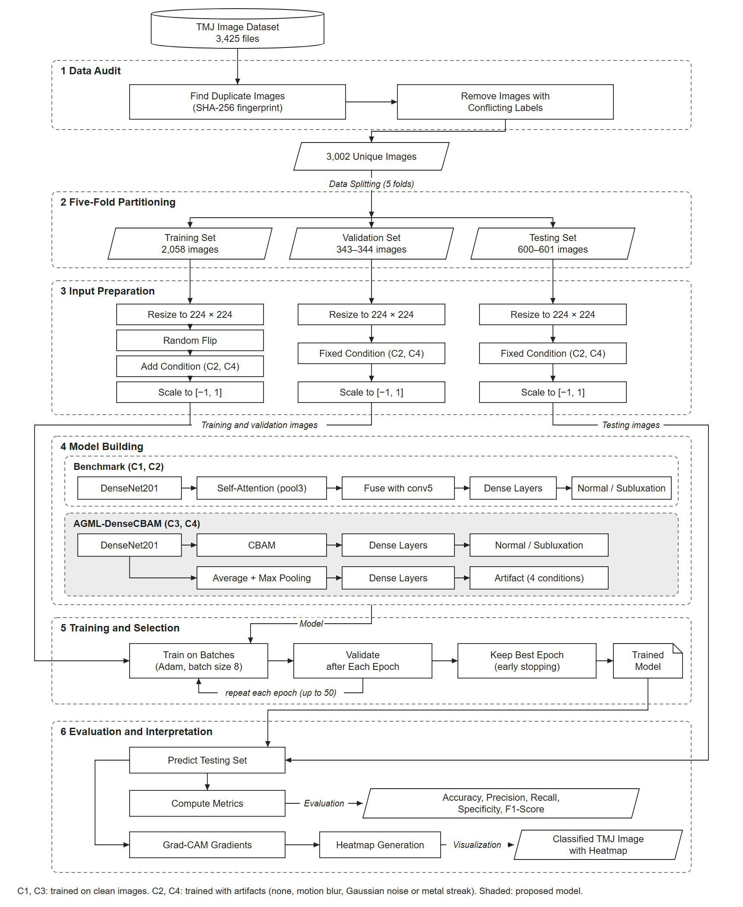
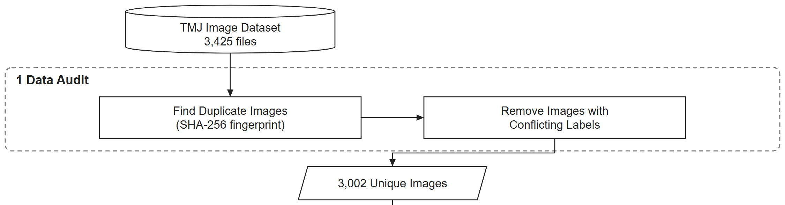
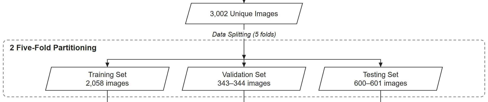
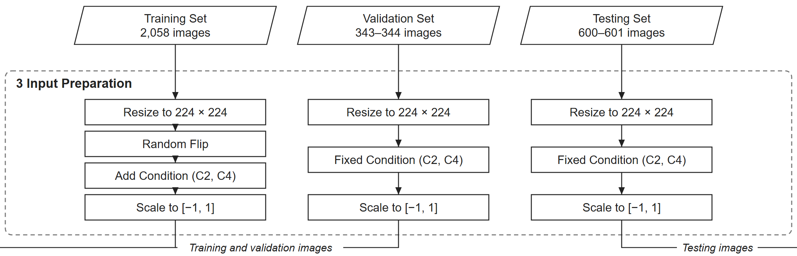
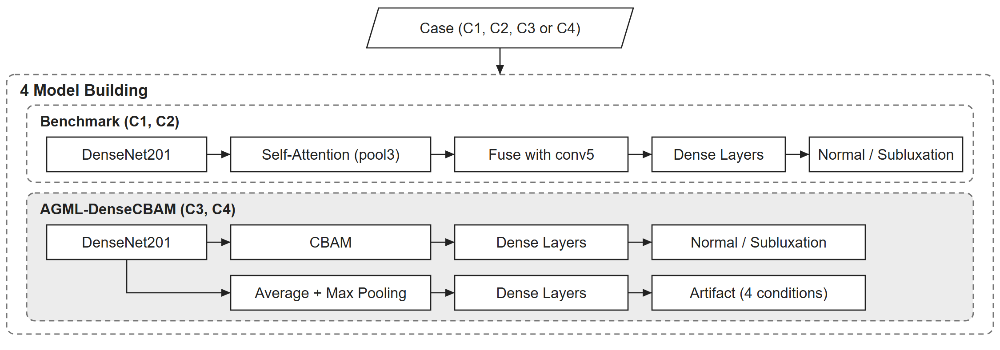
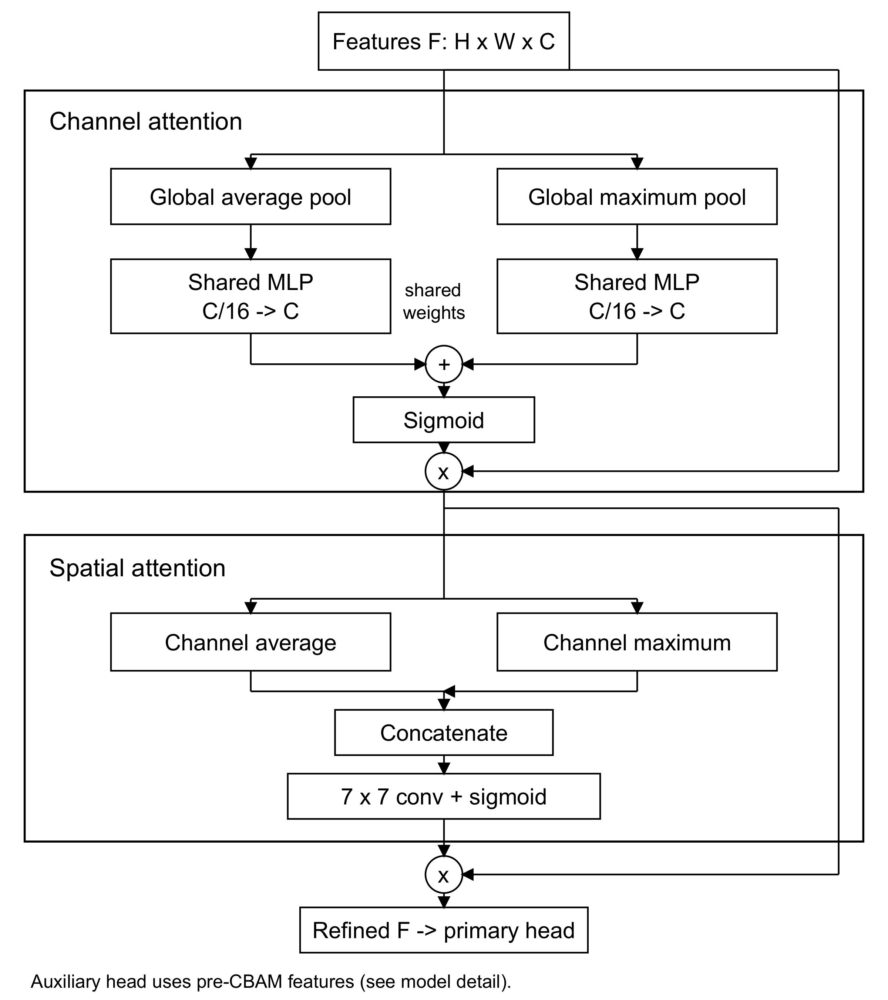
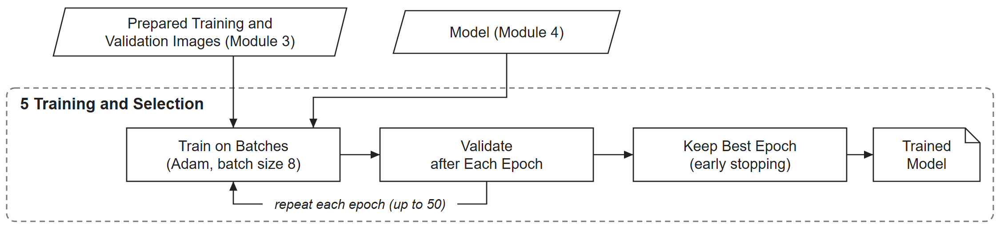
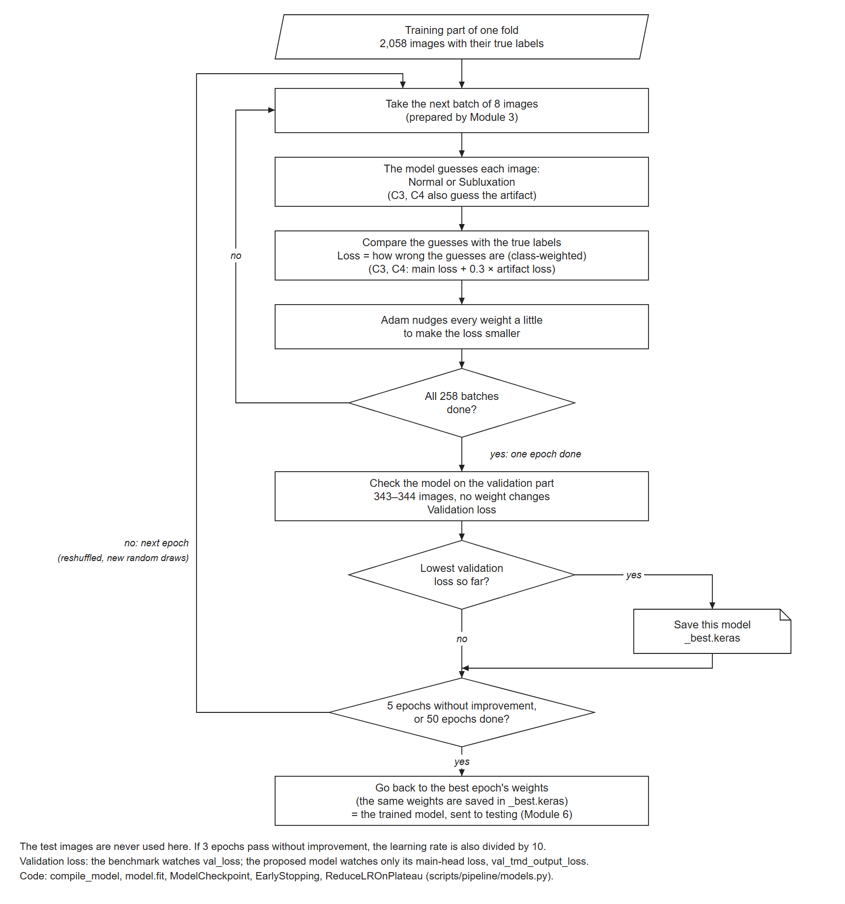
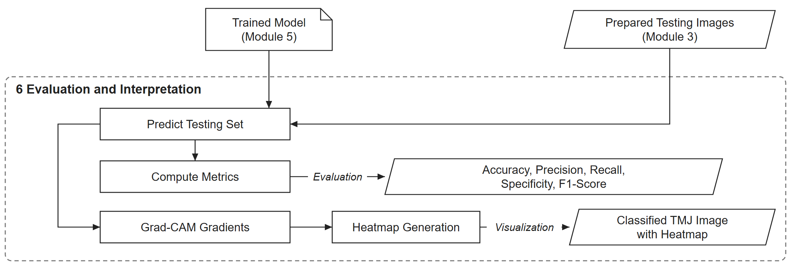

# System architecture

These are the architecture figures from Chapter IV of the manuscript, with the same numbering. They describe Final V2. V3 changed only the training recipe (see [Technical notes](TECHNICAL_NOTES.md#versions)).

*Figure 4.1: System architecture* ([SVG](figures/architecture.svg))

The six modules run once per fold, in the order `run_one_fold` in `scripts/pipeline/experiment.py` calls them.

| Figure | Module | Input | Output |
|---|---|---|---|
| 4.2 | 1 Data audit | 3,425 source files | 3,002 unique images, after removing duplicates and conflicting labels |
| 4.3 | 2 Five-fold partitioning | 3,002 images | Per fold: 2,058 training, 343–344 validation and 600–601 testing images |
| 4.4 | 3 Input preparation | The three sets and the case | Images resized to 224 × 224, flipped (training only), given a condition (C2, C4) and scaled to [−1, 1] |
| 4.5 | 4 Model building | The case | The benchmark (C1, C2) or AGML-DenseCBAM (C3, C4) |
| 4.7 | 5 Training and selection | Prepared training and validation images, and the model | The trained model from the best epoch |
| 4.9 | 6 Evaluation and interpretation | The trained model and the prepared testing images | Metrics and Grad-CAM heatmaps |

Figure 4.6 shows the CBAM block inside Module 4, and Figure 4.8 shows the training loop inside Module 5.

The two models are alternatives, not an ensemble. Testing images go straight to Module 6 and never reach training. Grad-CAM uses the saved model and does not feed back into training.

## Module figures

### Figure 4.2: Module 1, data audit

### Figure 4.3: Module 2, five-fold partitioning

### Figure 4.4: Module 3, input preparation

### Figure 4.5: Module 4, model building

### Figure 4.6: Implemented CBAM channel and spatial attention (based on Woo et al., 2018)

### Figure 4.7: Module 5, training and selection

### Figure 4.8: Training loop and best-epoch selection in Module 5

### Figure 4.9: Module 6, evaluation and interpretation

## Updating the figures

Each figure has a PNG and an SVG in `docs/figures/`. They are copies of the manuscript figures, drawn by `output/thesis_refresh_v3/tools/build_ds03_format_chapter4.py` (Figures 4.1 to 4.5, 4.7 and 4.9) and `build_training_loop_figure.py` (Figure 4.8). `output/` is not in Git. If the paper's figures change, copy the new files here under the same names. The notebooks use `architecture.png` and `training_loop.png` from this folder.
