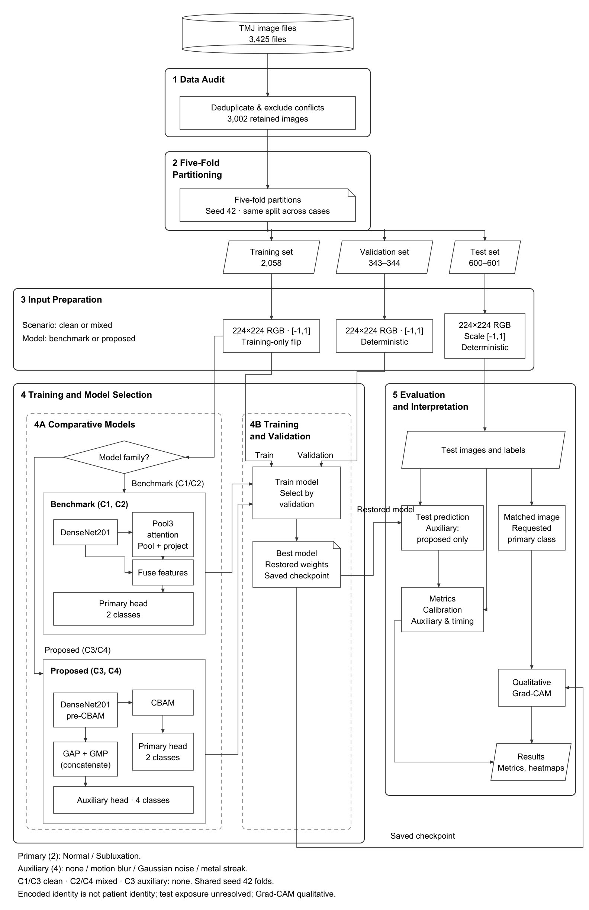

# System architecture

The approved diagram is **spacious master V3**, a grayscale 11 × 17 inch vector master. Do not edit it without checking the Word chapters. It describes Final V2.

[PDF](figures/approved/architecture_master.pdf) · [PNG](figures/approved/architecture_master.png) · [SVG](figures/approved/architecture_master.svg)

## Modules

| Chapter IV figure | Module | Input and output | Assets |
|---|---|---|---|
| 4.2 | Data audit | Source images and labels → retained image records | [PNG](figures/approved/module_1.png) / [PDF](figures/approved/module_1.pdf) |
| 4.3 | Five-fold partitioning | Retained records → training, validation and test sets | [PNG](figures/approved/module_2.png) / [PDF](figures/approved/module_2.pdf) |
| 4.4 | Input preparation | Set and case → prepared batches (the flip is training-only) | [PNG](figures/approved/module_3.png) / [PDF](figures/approved/module_3.pdf) |
| 4.5 | Training and model selection | Benchmark or proposed model → best model and saved checkpoint | [PNG](figures/approved/module_4.png) / [PDF](figures/approved/module_4.pdf) |
| 4.6 | CBAM detail | Channel attention, then spatial attention | [PNG](figures/approved/cbam_detail.png) / [PDF](figures/approved/cbam_detail.pdf) |
| 4.7 | Evaluation and interpretation | Best model and test images → metrics and Grad-CAM | [PNG](figures/approved/module_5.png) / [PDF](figures/approved/module_5.pdf) |

The two models are alternatives trained by one fitting procedure, not an ensemble. Test images bypass fitting. Grad-CAM uses the saved model and does not feed back into training.

`approved_assets.json` records the hash of each figure, and `tests/test_approved_architecture_assets.py` checks them.
